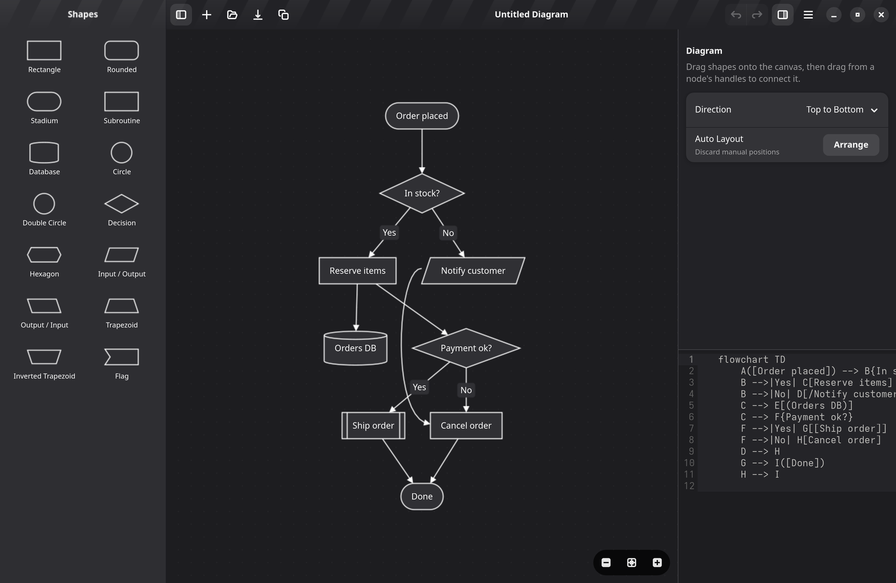
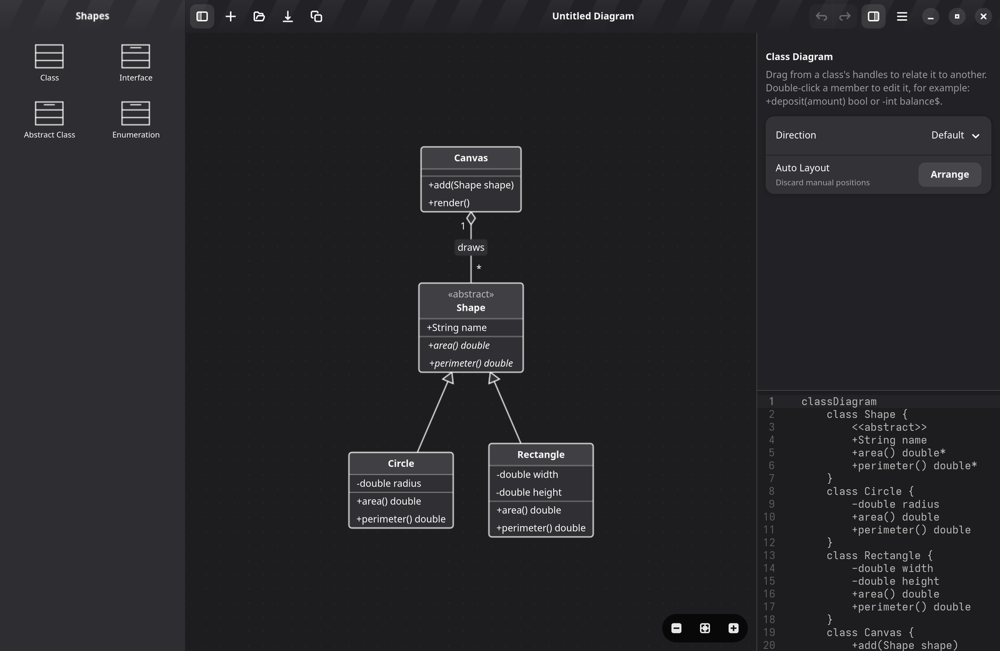
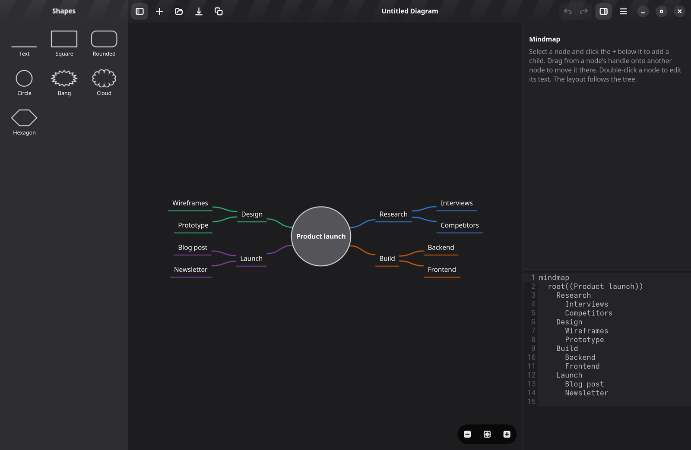

# Reefgraph

> Visual WYSIWYG editor for Mermaid diagrams for Linux. Built with GTK, Rust and LibAdwaita.

[](https://github.com/brpaz/reefgraph/actions/workflows/ci.yml)
[](LICENSE.md)
[](https://flatpak.org)
[](#reefgraph)

> [!WARNING]
> **AI usage notice:** this project was fully vibe coded in a weekend with Claude Opus 5.5 to scratch a personal itch. The code has had little human review. Use it at your own risk, and keep backups of diagrams you care about.

<div align="center">



</div>

<table>
  <tr>
    <td></td>
    <td></td>
  </tr>
</table>

## Features

- Edit diagrams on a canvas: drag shapes from a palette, link them by dragging, edit text in place.
- Diagram types: flowchart, sequence, state, class, entity relationship, C4, use case and mindmap.
- The Mermaid source updates as you edit, and edits to the source update the canvas.
- Files stay plain Mermaid; manual positions are stored as Mermaid comments.
- Open and save Mermaid blocks inside Markdown files.
- Start a diagram from Mermaid text on the clipboard.
- Export as SVG or PNG.

## Install

Download the package for your system from the [latest release](https://github.com/brpaz/reefgraph/releases/latest):

```bash
# Flatpak
flatpak install --user dev.brunopaz.Reefgraph.flatpak
flatpak run dev.brunopaz.Reefgraph

# Debian/Ubuntu
sudo apt install ./reefgraph.deb

# Fedora
sudo dnf install ./reefgraph.rpm
```

## Build from Source

```bash
git clone https://github.com/brpaz/reefgraph
cd reefgraph
task run
```

Full prerequisites, running tests, building the Flatpak/`.deb`/`.rpm`, and the Taskfile reference: [CONTRIBUTING.md](CONTRIBUTING.md).

## Contributing

See [CONTRIBUTING.md](CONTRIBUTING.md).

## Contributors

<a href="https://github.com/brpaz/reefgraph/graphs/contributors">
  
</a>

## License

This repo is MIT licensed. See [LICENSE.md](LICENSE.md).
