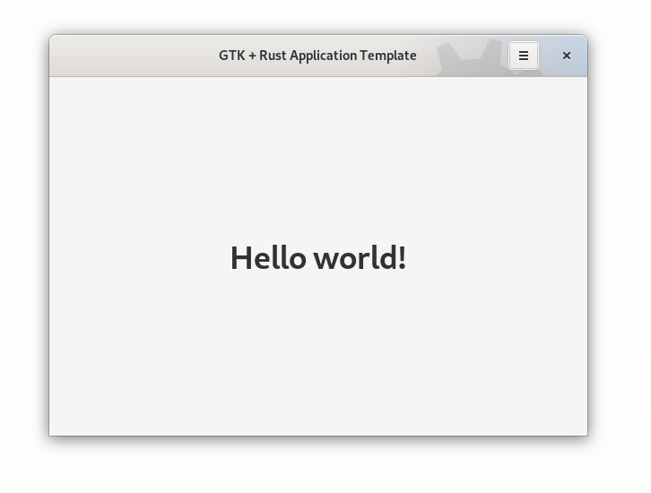

# Merman

> Visual WYSIWYG editor for Mermaid diagrams

[](https://github.com/brpaz/merman/actions/workflows/ci.yml)
[](LICENSE.md)
[](https://flatpak.org)

<div align="center">



</div>

## Features

- Visual editing of Mermaid flowcharts: drag shapes from the palette, drag between nodes to link them, double-click to edit labels
- Live two-way sync with the Mermaid source shown next to the canvas
- All flowchart node shapes, solid/dotted/thick links, arrow/circle/cross heads, link labels
- Automatic layered layout; manual positions are saved as Mermaid comments, so files stay valid Mermaid
- Undo/redo, zoom and pan, keyboard shortcuts

Sequence diagrams and entity relationship diagrams are planned.

## Install

Download the package for your system from the [latest release](https://github.com/brpaz/merman/releases/latest):

```bash
# Flatpak
flatpak install --user dev.brunopaz.Merman.flatpak
flatpak run dev.brunopaz.Merman

# Debian/Ubuntu
sudo apt install ./merman.deb

# Fedora
sudo dnf install ./merman.rpm
```

## Build from Source

```bash
git clone https://github.com/brpaz/merman
cd merman
task run
```

Full prerequisites, running tests, building the Flatpak/`.deb`/`.rpm`, and the Taskfile reference: [CONTRIBUTING.md](CONTRIBUTING.md).

## Contributing

See [CONTRIBUTING.md](CONTRIBUTING.md).

## Contributors

<a href="https://github.com/brpaz/merman/graphs/contributors">
  
</a>

## License

This repo is MIT licensed. See [LICENSE.md](LICENSE.md).
