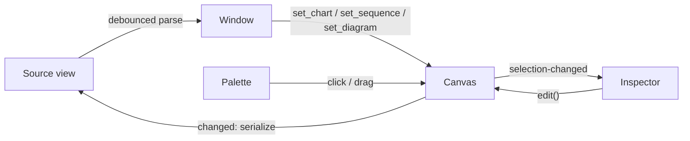

# Architecture

Merman is a GTK4/libadwaita application written in Rust for editing Mermaid flowcharts, sequence diagrams, class diagrams and entity relationship diagrams. UI layouts are Blueprint files compiled to GtkBuilder XML at build time and bundled into a GResource.

## Modules

```
src/
├── main.rs              # i18n, resource loading, application start
├── application.rs       # AdwApplication: actions, accelerators, about dialog, file open from CLI
├── window.rs            # Main window: picks the editor for the diagram type, source <-> canvas sync, file I/O
├── diagram.rs           # Diagram type detection and parse dispatch
├── syntax.rs            # Shared parsing: ParseError, front matter/declaration split, `;` statements
├── ids.rs               # Element id rules shared by the models
├── geometry.rs          # Point, Rect
├── viewport.rs          # Pan/zoom mapping between canvas and widget coordinates
├── history.rs           # Snapshot undo/redo stack
├── layered.rs           # Layered auto layout and flow Direction, for node-link diagrams
├── routing.rs           # Edge paths: outline clipping, parallel bends, detours around nodes
├── drawing.rs           # Colors, label layout, text and Cairo helpers shared by the canvases
├── interaction.rs       # Navigable trait (scroll/zoom/pan), InlineEditor popover
├── box_canvas.rs        # MermanBoxCanvas: shared canvas for box-and-link diagrams (BoxDiagram trait)
├── palette.rs           # MermanPalette: tiles supplied by the active editor
├── combo.rs, labels.rs  # Combo row models and translatable enum names
├── flowchart/           # Flowchart domain (no GTK): model, parser, serializer, layered layout
├── flowchart_editor/    # MermanFlowchartCanvas, MermanFlowchartInspector, shape geometry and rendering
├── sequence/            # Sequence domain (no GTK): model, parser, serializer, layout and hit testing
├── sequence_editor/     # MermanSequenceCanvas, MermanSequenceInspector, rendering
├── class_diagram/       # Class diagram domain (no GTK): model, parser, serializer, class box geometry, layout
├── class_editor/        # BoxDiagram for class diagrams, MermanClassInspector, UML relation heads
├── erd/                 # ERD domain (no GTK): model, parser, serializer, entity box geometry, layout
└── erd_editor/          # BoxDiagram for ERDs, MermanErdInspector, crow's-foot rendering

data/resources/ui/*.blp  # Blueprint templates for window, palette, inspectors, shortcuts
```

Each diagram type is a pair of modules: a GTK-free domain module covered by plain `cargo test`, and an editor module with its properties panel. Editor modules depend on the domain and the shared modules, never on each other.

Flowcharts and sequence diagrams have their own canvas widgets. Class diagrams and ERDs share `MermanBoxCanvas`, which implements moving, linking, the add-row button, in-place editing, undo and navigation once; each diagram type implements the `BoxDiagram` trait (geometry, rendering, what rows are and how edited text applies). Inspectors reach the typed model through `BoxCanvas::with::<M>` and `BoxCanvas::edit::<M>`.

## Data Flow



- The window shows one editor at a time, chosen from the diagram declaration (`flowchart`/`graph`, `sequenceDiagram`, `classDiagram` or `erDiagram`). Typing a different declaration in the source loads the diagram into the other editor.
- Each canvas owns its model. Every user edit goes through `edit`/`try_edit`, which records an undo snapshot and emits `changed`.
- The window turns `changed` into Mermaid text, replacing the buffer contents as one undoable step. While it does so it sets a `syncing` flag so the change is not parsed back.
- Text edits are parsed 300 ms after the last keystroke. A valid result replaces the canvas model; a parse error is shown in a banner and the canvas is left alone.
- Canvas signals: `changed` (user edit), `selection-changed`, `history-changed` (undo/redo availability).

## Canvas Interaction

All canvases: scroll to pan, Ctrl+scroll to zoom around the pointer, middle-drag or drag on empty space to pan, double-click to edit text in place, Delete, F2, Ctrl+Z, Ctrl+Shift+Z, Escape.

### Flowchart

| Gesture | Effect |
|---|---|
| Drag node | Move (snapped to a 10 px grid) |
| Drag from a node handle, or Shift+drag a node | Create a link to the node under the pointer on release |
| Double-click empty space | Add a rectangle and edit its label |
| Drop a palette tile | Add that shape at the drop point |

Edges between the same pair of nodes are bent apart. An edge whose straight path crosses another node is rerouted as an arc on the first side that clears all nodes.

### Sequence diagram

| Gesture | Effect |
|---|---|
| Drag a participant box sideways | Reorder participants |
| Drag from a lifeline to another lifeline | Add a message at that height (right of its own lifeline: message to self) |
| Drag a message, note or block edge up or down | Move that row; moves that would unbalance a block are rejected |
| Double-click the header area | Add a participant |
| Drop a palette tile | Participant/actor: insert at that column. Note: right of the nearest lifeline. Block: wrap the message or note under the pointer, or add an empty block |

### Entity relationship diagram

| Gesture | Effect |
|---|---|
| Drag entity | Move (snapped to a 10 px grid) |
| Drag from an entity handle, or Shift+drag an entity | Create a one-to-many relationship to the entity under the pointer |
| Click the "+" below the selected entity | Add an attribute and edit it |
| Double-click the header | Rename the entity, or edit its alias when it has one |
| Double-click an attribute | Edit the attribute as text: `type name [PK, FK, UK] ["comment"]` |
| Double-click empty space | Add an entity and name it |

Relationships use the shared edge routing and are drawn with crow's-foot markers for their cardinalities; non-identifying ones are dashed.

### Class diagram

Same gestures as entity relationship diagrams: drag to move, drag from a handle to relate (a `-->` association), "+" under the selected class adds a member, double-click the header to rename and a member to edit its text. Members are kept as written; those containing `(` are listed in the method compartment, `$` and `*` render underlined (static) and italic (abstract), and `~T~` generics display as `<T>`. Relation heads (inheritance, composition, aggregation, arrow, lollipop) are set per end in the inspector.

### Blocks in sequence diagrams

Blocks (`loop`, `alt`, `opt`, `par`, `critical`, `break`, `rect`) are stored as flat start/branch/end markers in the item list, so their extent changes by dragging the markers like any other row. `Sequence::validate` keeps them balanced.

## File Format

Files are plain Mermaid. **Copy Mermaid Source** (Ctrl+Shift+C) copies the source without the `%% @merman pos` lines, for pasting where Mermaid is rendered.

- Flowcharts: manually placed nodes are stored as `%% @merman pos <id> <x> <y>` comments; see [ADR 0002](adr/0002-store-node-positions-in-mermaid-comments.md). `classDef`, `class`, `style`, `linkStyle`, `click` and comments are kept verbatim. `subgraph` is rejected with a parse error.
- Entity relationship diagrams: manually placed entities use the same position comments as flowcharts. Relationships written with word aliases (`only one to zero or more`) are normalized to symbols when the canvas rewrites the source. `classDef`, `class`, `style` and comments are kept verbatim.
- Class diagrams: manually placed classes use the same position comments. Classes only mentioned in relations are declared with `class Name` when the canvas rewrites the source. `note`, `click`, `link`, `callback`, `cssClass`, `classDef`, `style` and comments are kept verbatim; `namespace` and `:::style` are rejected with a parse error.
- Sequence diagrams: layout follows participant and statement order, so no positions are stored. Participants are always declared explicitly when serializing. `links`, `link`, `properties`, `details` and comments are kept verbatim. `box`, `create` and `destroy` are rejected with a parse error.

## Decisions

- [ADR 0001: Native canvas with own Mermaid parser](adr/0001-native-canvas-with-own-mermaid-parser.md)
- [ADR 0002: Store node positions in Mermaid comments](adr/0002-store-node-positions-in-mermaid-comments.md)
