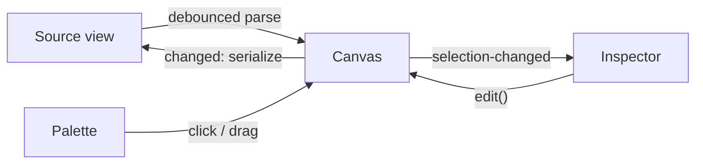

# Architecture

Merman is a GTK4/libadwaita application written in Rust. UI layouts are Blueprint files compiled to GtkBuilder XML at build time and bundled into a GResource.

## Modules

```
src/
├── main.rs            # i18n, resource loading, application start
├── application.rs     # AdwApplication: actions, accelerators, about dialog, file open from CLI
├── window.rs          # Main window: wires components, source <-> canvas sync, file I/O
├── flowchart/         # Domain, no GTK dependency
│   ├── model.rs       # Flowchart, Node, Edge, shapes, strokes, heads
│   ├── parser.rs      # Mermaid flowchart text -> model
│   ├── serializer.rs  # Model -> Mermaid flowchart text
│   └── layout.rs      # Layered auto layout
├── canvas/            # MermanCanvas widget
│   ├── mod.rs         # State, gestures, drag-and-drop, inline label editor, rendering
│   ├── geometry.rs    # Shape sizes, outline clipping, edge paths and routing, hit testing
│   ├── render.rs      # Cairo drawing of shapes, edges, handles
│   └── history.rs     # Snapshot undo/redo stack
├── palette.rs         # MermanPalette: shape tiles (click or drag onto the canvas)
├── inspector.rs       # MermanInspector: properties of diagram / node / link
└── labels.rs          # Translatable names for model enums

data/resources/ui/*.blp  # Blueprint templates for window, palette, inspector, shortcuts
```

`flowchart` is pure Rust and holds all parsing, serialization and layout logic, so it is covered by plain `cargo test`. The GTK modules depend on it, never the other way around.

## Data Flow



- The canvas owns the current `Flowchart`. Every user edit goes through `Canvas::edit`, which records an undo snapshot and emits `changed`.
- The window turns `changed` into Mermaid text. While it rewrites the buffer it sets a `syncing` flag so the change is not parsed back.
- Text edits are parsed 300 ms after the last keystroke. A valid result replaces the canvas chart (`Canvas::set_chart`), keeping current positions of nodes the text does not position. A parse error is shown in a banner and the canvas is left alone.
- Canvas signals: `changed` (user edit), `selection-changed`, `history-changed` (undo/redo availability).

## Canvas Interaction

| Gesture | Effect |
|---|---|
| Drag node | Move (snapped to a 10 px grid) |
| Drag from a node handle, or Shift+drag a node | Create a link to the node under the pointer on release |
| Drag empty space / middle-drag / scroll | Pan |
| Ctrl+scroll | Zoom around the pointer |
| Double-click node or link | Edit label inline |
| Double-click empty space | Add a rectangle and edit its label |
| Drop a palette tile | Add that shape at the drop point |
| Delete, F2, Ctrl+Z, Ctrl+Shift+Z, Escape | Delete, rename, undo, redo, clear selection |

Edges between the same pair of nodes are bent apart. An edge whose straight path crosses another node is rerouted as an arc on the first side that clears all nodes.

## File Format

Files are plain Mermaid. Manually placed nodes are stored as `%% @merman pos <id> <x> <y>` comments; see [ADR 0002](adr/0002-store-node-positions-in-mermaid-comments.md). Statements the model does not cover (`classDef`, `class`, `style`, `linkStyle`, `click`, comments) are kept verbatim. `subgraph` is rejected with a parse error.

## Decisions

- [ADR 0001: Native canvas with own Mermaid parser](adr/0001-native-canvas-with-own-mermaid-parser.md)
- [ADR 0002: Store node positions in Mermaid comments](adr/0002-store-node-positions-in-mermaid-comments.md)
