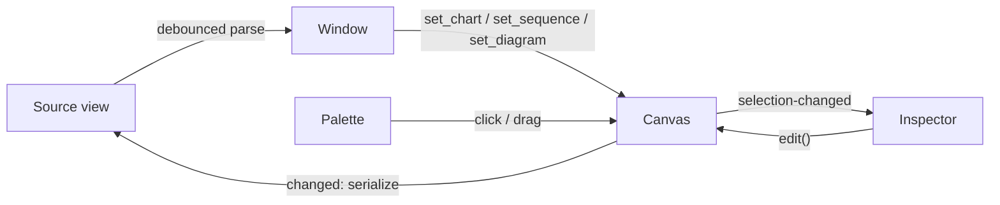

# Architecture

Merman is a GTK4/libadwaita application written in Rust for editing Mermaid flowcharts, sequence diagrams, class diagrams and entity relationship diagrams. UI layouts are Blueprint files compiled to GtkBuilder XML at build time and bundled into a GResource.

## Modules

```
src/
├── main.rs              # i18n, resource loading, application start
├── application.rs       # AdwApplication: actions, accelerators, about dialog, file open from CLI
├── window.rs            # Main window: picks the editor for the diagram type, source <-> canvas sync, file I/O
├── diagram.rs           # Diagram type detection and parse dispatch; DiagramKind templates and samples
├── new_diagram.rs       # New Diagram dialog: one tile per DiagramKind with a rendered sample preview
├── syntax.rs            # Shared parsing: ParseError, front matter/declaration split, `;` statements
├── ids.rs               # Element id rules shared by the models
├── geometry.rs          # Point, Rect
├── viewport.rs          # Pan/zoom mapping between canvas and widget coordinates
├── history.rs           # Snapshot undo/redo stack
├── layered.rs           # Layered auto layout and flow Direction, for node-link diagrams
├── routing.rs           # Edge paths: outline clipping, parallel bends, detours around nodes
├── drawing.rs           # Colors, label layout, text and Cairo helpers shared by the canvases
├── interaction.rs       # Navigable trait (scroll/zoom/pan), InlineEditor popover
├── export.rs            # SVG/PNG export: Exportable trait, Scene, render to a Cairo surface
├── markdown.rs          # Mermaid fenced blocks in Markdown: find, extract, write back
├── box_canvas.rs        # MermanBoxCanvas: shared canvas for box-and-link diagrams (BoxDiagram trait)
├── palette.rs           # MermanPalette: tiles supplied by the active editor
├── combo.rs, labels.rs  # Combo row models and translatable enum names
├── flowchart/           # Flowchart domain (no GTK): model, parser, serializer, layered layout
├── flowchart_editor/    # MermanFlowchartCanvas, MermanFlowchartInspector, shape geometry and rendering
├── sequence/            # Sequence domain (no GTK): model, parser, serializer, layout and hit testing
├── sequence_editor/     # MermanSequenceCanvas, MermanSequenceInspector, rendering
├── class_diagram/       # Class diagram domain (no GTK): model, parser, serializer, class box geometry, layout
├── class_editor/        # BoxDiagram for class diagrams, MermanClassInspector, UML relation heads
├── erd/                 # ERD domain (no GTK): model, parser, serializer, entity box geometry, layout
└── erd_editor/          # BoxDiagram for ERDs, MermanErdInspector, crow's-foot rendering

data/resources/ui/*.blp  # Blueprint templates for window, palette, inspectors, shortcuts
```

New documents are created from the **New Diagram** dialog (Ctrl+N or the "+" header button). Its **From Clipboard** section reads the clipboard text when the dialog opens and offers a tile for every diagram in it that parses: the whole text, or each `mermaid` block when it is Markdown (`markdown::pasted_diagrams`). Invalid text yields no tile, so the current document is never replaced by a broken one. Below it, **Empty Diagram** lists `DiagramKind::ALL`; each tile shows the kind's sample diagram rendered with the export code, a name and a description from `labels.rs`. The dialog hands the window the chosen source text, which it loads as an untitled document. Adding a diagram type to the dialog takes a `DiagramKind` variant with a template and sample, its labels, and a preview arm in `new_diagram.rs`.

Each diagram type is a pair of modules: a GTK-free domain module covered by plain `cargo test`, and an editor module with its properties panel. Editor modules depend on the domain and the shared modules, never on each other.

Flowcharts and sequence diagrams have their own canvas widgets. Class diagrams and ERDs share `MermanBoxCanvas`, which implements moving, linking, the add-row button, in-place editing, undo and navigation once; each diagram type implements the `BoxDiagram` trait (geometry, rendering, what rows are and how edited text applies). Inspectors reach the typed model through `BoxCanvas::with::<M>` and `BoxCanvas::edit::<M>`; see [ADR 0003](adr/0003-shared-box-canvas.md).

## Data Flow



- The window shows one editor at a time, chosen from the diagram declaration (`flowchart`/`graph`, `sequenceDiagram`, `classDiagram` or `erDiagram`). Typing a different declaration in the source loads the diagram into the other editor.
- Each canvas owns its model. Every user edit goes through `edit`/`try_edit`, which records an undo snapshot and emits `changed`.
- The window turns `changed` into Mermaid text, replacing the buffer contents as one undoable step. While it does so it sets a `syncing` flag so the change is not parsed back.
- Text edits are parsed 300 ms after the last keystroke. A valid result replaces the canvas model; a parse error is shown in a banner and the canvas is left alone.
- Canvas signals: `changed` (user edit), `selection-changed`, `history-changed` (undo/redo availability).

## Canvas Interaction

All canvases: scroll to pan, Ctrl+scroll to zoom around the pointer, middle-drag or drag on empty space to pan, double-click to edit text in place, Delete, F2, Ctrl+Z, Ctrl+Shift+Z, Escape.

Ctrl+C copies the selected node, box, participant, message or note into the canvas; Ctrl+V adds a copy as it was when copied. Nodes and boxes land diagonally next to where they were copied from, participants right of the original, messages and notes below the selected row (or the original row). Copies take a fresh id (`ids::next_free_id` for nodes and participants, `ids::copy_id` for classes and entities) and keep a custom label. The clipboard is per canvas, not the system clipboard, so the text editor's copy and paste are unaffected.

### Flowchart

| Gesture | Effect |
|---|---|
| Drag node | Move (snapped to a 10 px grid) |
| Drag from a node handle, or Shift+drag a node | Create a link to the node under the pointer on release |
| Double-click empty space | Add a rectangle and edit its label |
| Drop a palette tile | Add that shape at the drop point |

Edges between the same pair of nodes are bent apart. An edge whose straight path crosses another node is rerouted as an arc on the first side that clears all nodes.

### Sequence diagram

| Gesture | Effect |
|---|---|
| Drag a participant box sideways | Reorder participants |
| Drag from a lifeline to another lifeline | Add a message at that height (right of its own lifeline: message to self) |
| Drag a message, note or block edge up or down | Move that row; moves that would unbalance a block are rejected |
| Double-click the header area | Add a participant |
| Drop a palette tile | Participant/actor: insert at that column. Note: right of the nearest lifeline. Block: wrap the message or note under the pointer, or add an empty block |

### Entity relationship diagram

| Gesture | Effect |
|---|---|
| Drag entity | Move (snapped to a 10 px grid) |
| Drag from an entity handle, or Shift+drag an entity | Create a one-to-many relationship to the entity under the pointer |
| Click the "+" below the selected entity | Add an attribute and edit it |
| Double-click the header | Rename the entity, or edit its alias when it has one |
| Double-click an attribute | Edit the attribute as text: `type name [PK, FK, UK] ["comment"]` |
| Double-click empty space | Add an entity and name it |

Relationships use the shared edge routing and are drawn with crow's-foot markers for their cardinalities; non-identifying ones are dashed.

### Class diagram

Same gestures as entity relationship diagrams: drag to move, drag from a handle to relate (a `-->` association), "+" under the selected class adds a member, double-click the header to rename and a member to edit its text. Members are kept as written; those containing `(` are listed in the method compartment, `$` and `*` render underlined (static) and italic (abstract), and `~T~` generics display as `<T>`. Relation heads (inheritance, composition, aggregation, arrow, lollipop) are set per end in the inspector.

### Blocks in sequence diagrams

Blocks (`loop`, `alt`, `opt`, `par`, `critical`, `break`, `rect`) are stored as flat start/branch/end markers in the item list, so their extent changes by dragging the markers like any other row. `Sequence::validate` keeps them balanced.

## Image Export

**Export Image** (Ctrl+E) writes the current diagram as SVG, or as PNG when the chosen file name ends in `.png`. Each canvas implements `export::Exportable`: `content_bounds` (shapes plus edge routes, also used by zoom-to-fit) and `draw_scene`, which its `snapshot` calls too. A `Scene` carries the viewport, size, colors and whether to draw the grid, selection and drag feedback. Export draws a non-interactive scene in light colors on white into a `gtk::Snapshot` and replays the resulting render node onto a Cairo SVG or image surface, so on-screen and exported drawing cannot diverge; see [ADR 0004](adr/0004-export-by-replaying-the-canvas-scene.md). PNGs are rendered at 2× scale.

## File Format

Files are plain Mermaid, or Markdown documents (`.md`, `.markdown`) with a diagram in a ```` ```mermaid ```` or `~~~mermaid` fenced block. Opening a Markdown file edits one block, chosen from a list when there are several; saving writes the document back with only that block's contents replaced. The fence's indentation is removed for editing and restored on save, so blocks nested in list items round-trip. Unclosed fences are ignored. When a line of the diagram would close the block early, both fences are lengthened; lines are written with the document's line ending. **Save As** to a Markdown file writes the whole document; to any other file it writes the diagram alone, and the document is no longer linked. **Copy Mermaid Source** (Ctrl+Shift+C) copies the source without the `%% @merman pos <id> <x> <y>` lines (other comments and line endings are kept), for pasting where Mermaid is rendered.

- Flowcharts: manually placed nodes are stored as `%% @merman pos <id> <x> <y>` comments; see [ADR 0002](adr/0002-store-node-positions-in-mermaid-comments.md). `classDef`, `class`, `style`, `linkStyle`, `click` and comments are kept verbatim. `subgraph` is rejected with a parse error.
- Entity relationship diagrams: manually placed entities use the same position comments as flowcharts. Relationships written with word aliases (`only one to zero or more`) are normalized to symbols when the canvas rewrites the source. `classDef`, `class`, `style` and comments are kept verbatim.
- Class diagrams: manually placed classes use the same position comments. Classes only mentioned in relations are declared with `class Name` when the canvas rewrites the source. `note`, `click`, `link`, `callback`, `cssClass`, `classDef`, `style` and comments are kept verbatim; `namespace` and `:::style` are rejected with a parse error.
- Sequence diagrams: layout follows participant and statement order, so no positions are stored. Participants are always declared explicitly when serializing. `links`, `link`, `properties`, `details` and comments are kept verbatim. `box`, `create` and `destroy` are rejected with a parse error.

## Decisions

- [ADR 0001: Native canvas with own Mermaid parser](adr/0001-native-canvas-with-own-mermaid-parser.md)
- [ADR 0002: Store node positions in Mermaid comments](adr/0002-store-node-positions-in-mermaid-comments.md)
- [ADR 0003: Shared canvas for box-and-link diagrams](adr/0003-shared-box-canvas.md)
